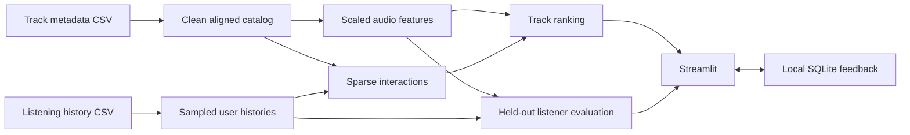

# Project architecture

Track IDs align catalog rows, feature rows and sparse matrix rows, so duplicate song titles remain independently selectable. The matrix stores tracks as rows and listeners as columns for item-to-item queries. Each nonzero stores log(1 + play count). CSR storage scales with observed pairs. A query computes one similarity vector and avoids storing a full pairwise matrix.

- **Content** uses cosine similarity of min–max scaled audio features.
- **Collaborative** uses cosine similarity of sparse listening vectors. A seed with no history uses audio features. Tracks with no shared listening evidence are omitted from pure collaborative results.
- **Hybrid** weights normalized audio similarity and collaborative cosine. The diversity slider increases the collaborative weight.
- **Discovery** ranks tracks by the number of sampled listeners, and supports genre and mood filters.
- **Feedback** stores favorites and hidden tracks locally. Hidden items are excluded from rankings. Favorites appear in a saved list.

DVC records stage dependencies and outputs. The local remote holds content-addressed copies of CSVs and artifacts. The pipeline uses the original schemas and preserves track-to-track cosine and weighted fusion. The upstream experimental modules remain available for reference.
